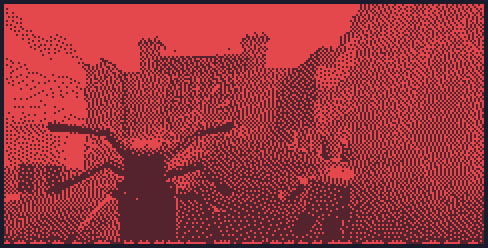
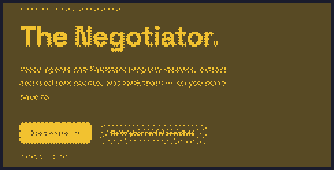
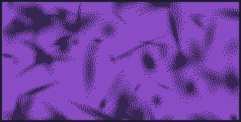
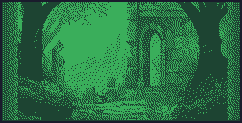
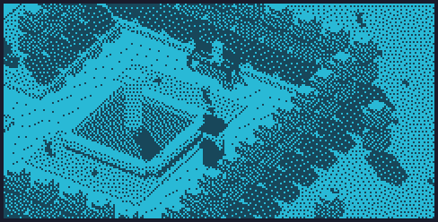
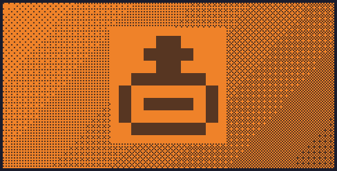

<picture>
  <source media="(prefers-color-scheme: dark)" srcset="assets/header-dark.svg">
  
</picture>

  
  
  

I'm a final-year Computer Science student at FAST-NUCES Lahore. I build where real-time graphics, computer vision and game systems meet: a co-op horde-defense game, voice agents that negotiate for you, and a final-year project on 3D Gaussian Splatting.

## Featured work

<table>
<tr>
<td width="50%" valign="top">

**Walls Were Built to Fall** 
Co-op horde-defense roguelite FPS on Roblox. Hold a castle wall against a demon horde with towers, traps and 130 spell cards that evolve and combo. Every model is built procedurally from primitives. 
Roblox, Luau, multiplayer, launching on Roblox soon
</td>
<td width="50%" valign="top">

**[The Negotiator](https://negotiator-frontend-iota.vercel.app/)** 
Built at HackNation. AI voice agents call property dealers, pull itemised rent quotes out of live calls and return a ranked report. Every figure cites its transcript line, like [Call 3, Line 41]. 
Voice agents, AI, hackathon
</td>
</tr>
<tr>
<td width="50%" valign="top">

**Feed-forward Gaussian Splatting** (final-year project) 
One pipeline benchmarks MVSplat, NoPoSplat and AnySplat on the same data and GPUs, then tests pruning, compression and keyframe selection. Ships with a web viewer and an Android capture app. 
3D vision, benchmarking, Android, in progress
</td>
<td width="50%" valign="top">

**[Riposte](https://github.com/irfy2k/2d-Game)** 
Fast 2D parry combat in Unity. Custom hitboxes, frame-perfect deflect timing, and goblins that stun with a blue flash when you land a parry. 
Unity, C#, combat AI
</td>
</tr>
<tr>
<td width="50%" valign="top">

**[Voxl v1](https://voxl-portfolio.vercel.app)** 
3D web portfolio with custom GLSL shaders, runtime mesh deformation and scroll-driven camera moves. Its voxel sandbox extrudes pixel drawings into geometry. [Code](https://github.com/irfy2k/Voxl-Portfolio). 
Three.js, GLSL, JavaScript
</td>
<td width="50%" valign="top">

**SCNT Studio** (client work) 
Paid WooCommerce storefront for a perfume brand, built end to end in June 2026: catalog and variants, checkout, a custom responsive theme and on-page SEO. Launching at scnt.studio this month. 
WordPress, WooCommerce, SEO
</td>
</tr>
</table>

<b>More projects</b>

 

| Project | What it is | Built with |
|---|---|---|
| [FabricOS](https://customizer-three.vercel.app) | Browser-based 3D fabric customiser ([code](https://github.com/irfy2k/Customizer)) | JavaScript, 3D |
| Shorts Pipeline | Makes and uploads original YouTube Shorts end to end, with a source manifest per video | Python, ffmpeg, Claude |
| [ClinicalHub](https://github.com/irfy2k/ClinicalHub) | Clinic app: appointments, chat, prescriptions, push reminders | Expo, React Native, Firebase |
| [Daylight](https://daylight-lime-omega.vercel.app) | AI daily dashboard for mood, tasks and money ([code](https://github.com/irfy2k/Daylight)) | Next.js, TypeScript |

## The portfolio is a game of Tetris

Each page of [irfy2k.github.io/tetris](https://irfy2k.github.io/tetris/) is a stack of tetrominoes. Click a block to open it. Scroll, and an I piece drops into the gap and clears the line to the next page. It's a single HTML file with no dependencies. There's also [a Three.js lighthouse](https://irfy2k.github.io/lighthouse/) where each project is a ship, and [a one-page overview](https://irfy2k.github.io) with clips of everything.

## Toolbox

Also Luau and Roblox Studio, GLSL, SQL, ffmpeg and Odoo.

## Track record

- **Head of AI Competition**, SOFTEC 2026, FAST-NUCES.
- **Freelance developer**, SCNT Studio, June 2026.
- **Runner-up**, FAST speed-programming contest, November 2024.
- **Software engineering intern**, Mediod Consulting, July to August 2024. Odoo ERP modules.
- **Dean's List**, FAST-NUCES, first and sixth semesters.

## Get in touch

Open to part-time and freelance work alongside my degree, remote or in Lahore (UTC+5).
Email **irfy2k1@outlook.com**, or grab [my CV](https://irfy2k.github.io/ahmed-zuhair-cv.pdf). Older projects live on [@irfy2k321](https://github.com/irfy2k321).
