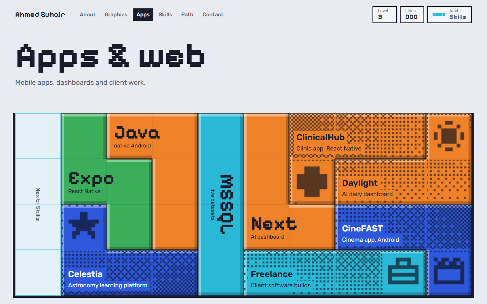

# Ahmed Zuhair

Design engineer in Lahore, final year of CS at FAST-NUCES. I build interactive systems where computer vision, real-time graphics and unconventional UI meet.

My [portfolio](https://irfy2k.github.io) is a game of Tetris. Each page is a stack of blocks, and clearing a line takes you to the next one.

## Things I've built

| Project | What it is | Built with |
|---|---|---|
| [Riposte](https://github.com/irfy2k/2d-Game) | Fast 2D parry-combat game with frame-perfect deflects | Unity, C# |
| [Voxl v1](https://voxl-portfolio.vercel.app) | 3D web portfolio with custom shaders and a voxel sandbox ([code](https://github.com/irfy2k/Voxl-Portfolio)) | Three.js, GLSL |
| [FabricOS](https://customizer-three.vercel.app) | Browser-based 3D fabric customiser ([code](https://github.com/irfy2k/Customizer)) | JavaScript, 3D |
| [ClinicalHub](https://github.com/irfy2k/ClinicalHub) | Clinic-management app: appointments, chat, prescriptions | Expo, React Native, Firebase |
| [Daylight](https://daylight-lime-omega.vercel.app) | AI daily dashboard for mood, tasks and money ([code](https://github.com/irfy2k/Daylight)) | Next.js, TypeScript, Tailwind |
| [CineFAST](https://github.com/irfy2k/SMD-Assignment2) | Native Android cinema app | Java, Android |
| [Flappy NASM](https://github.com/irfy2k321/NASM-16bit-flappy-bird) | Flappy Bird in 16-bit x86 assembly | NASM |

## Tools

- **Languages:** C, C++, C#, JavaScript, TypeScript, Python
- **Graphics:** Three.js, WebGL, GLSL, Unity, OpenCV
- **Shipping:** Git, Firebase, MSSQL, Odoo, Vercel

## Lately

- Head of AI at SOFTEC 2026, FAST-NUCES
- Runner-up, FAST speed-programming contest, Nov 2024
- Software engineering intern at Mediod Consulting, 2024

## Get in touch

Open to 2026 internships and full-time design-engineering roles, in Lahore or remote.
Email **irfy2k1@outlook.com**. Older projects live on [@irfy2k321](https://github.com/irfy2k321).
